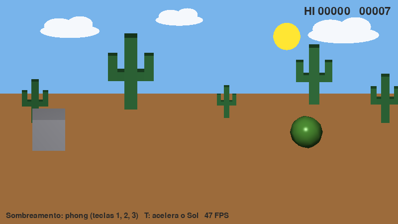
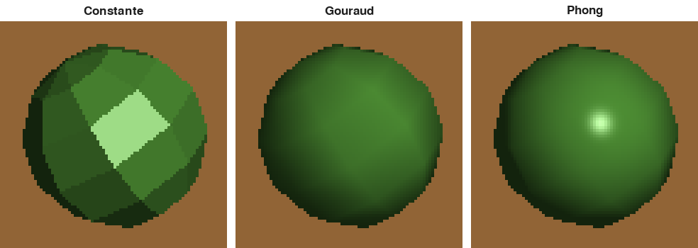
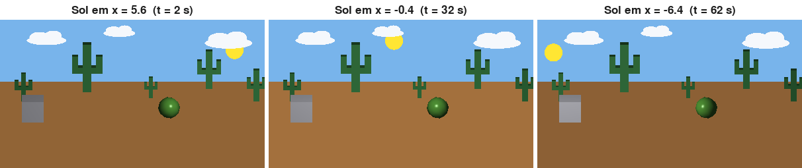
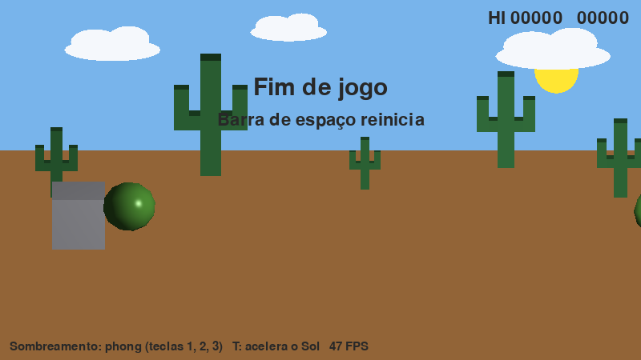

# Relatório técnico: T-Rex Game 3D

Computação Gráfica, UNIOESTE (Ciência da Computação), prof. Adair Santa Catarina. Trabalho 2, turma 2026.

Integrantes: _[nomes completos dos integrantes]_

Entrega: 02/12/2026. Apresentação: 03/12/2026, Laboratório 1.

## 1. Uso de ferramentas de IA

A seção 7 do enunciado considera irregular o uso de ferramentas de IA, salvo autorização. O grupo consultou o
professor por e-mail em _[data]_ e recebeu autorização _[resumir ou transcrever o trecho da resposta; guardar a
resposta completa em `docs/liberacao-ia.txt`]_. Com essa autorização, o desenvolvimento teve apoio do Claude Code
(Anthropic) em _[descrever: planejamento, implementação, testes, documentação]_. Os resultados esperados dos
casos de aceite (`tests/aceite/casos.json`) foram calculados à mão por _[quem]_. _[Revisar este parágrafo para
que reflita exatamente o que foi combinado e feito.]_

Todos os algoritmos de Computação Gráfica estão implementados no pacote `trex3d/` e são os estudados na
disciplina (seção 4). O `pygame` é usado apenas em `main.py` para abrir a janela, ler o teclado, exibir o quadro já
calculado e escrever o texto; o `numpy` guarda vetores, matrizes e o framebuffer.

## 2. Visão geral

Versão 3D do T-Rex Game do Chrome. O T-Rex é um **cubo** no lado esquerdo que salta com a barra de espaço. Os
cactos são **esferas** de 48 faces que entram pela direita, rolam e quicam. O **Sol** é uma esfera amarela que
cruza o céu devagar e é a fonte de luz da cena. Há terreno, céu, nuvens fixas e cactos decorativos de fundo em
escalas diferentes. A câmera é fixa, ortográfica, de frente, com 20 graus de elevação. O jogo termina quando o
cubo bate em uma esfera e a barra de espaço reinicia.



Janela de 800 x 450 pixels; 55 pixels por unidade do mundo; eixos x para a direita, y para cima, z para o
observador (mão direita).

## 3. Arquitetura

```
        teclado (main.py)
              |
       jogo.py (estados, colisão, pontos)
              |
       mundo.py (tempo: salto, esferas, Sol)          modelos.py (malhas)
              |                                              |
        cena.py: monta o quadro  <---------------------------+
              |
   para cada objeto:  preparar_faces ──> visibilidade.py (faces de costas, ordem do pintor)
              |                              |
              |                       camera.py (mundo → observador → pixels)
              v
   sombreamento.py ──> luz.py (cor por ponto)  e  raster.py (scanline) ──> framebuffer ──> janela
```

| Módulo | Responsabilidade |
|---|---|
| `mat.py` | Vetores e matrizes 4x4 homogêneas |
| `camera.py` | Sistema do observador, projeção ortográfica, janela→viewport |
| `modelos.py` | Malhas: cubo/caixa, esfera, plano, cacto |
| `visibilidade.py` | Faces de costas pela normal, ordem do pintor |
| `raster.py` | Preenchimento de polígonos por scanline com interpolação |
| `luz.py` | Iluminação ambiente + difusa + especular, materiais |
| `sombreamento.py` | Constante, Gouraud, Phong |
| `mundo.py` | Animação em função do tempo |
| `jogo.py` | Estados, colisão cubo x esfera, pontuação |
| `cenario.py` | Nuvens e cactos de fundo |
| `cena.py` | Ordem de pintura e montagem do quadro |

**Por quadro**: `Jogo.avancar(dt)` atualiza o tempo; `Cena.desenhar` pinta, nesta ordem, céu, Sol, nuvens,
terreno, cactos de fundo e, por último, cubo e esferas do mais longe ao mais perto (algoritmo do pintor). O
framebuffer é um `numpy.ndarray` (largura, altura, 3) que o `pygame` apenas exibe.

## 4. Técnicas de Computação Gráfica

Entre parênteses, a seção da apostila.

**4.1 Representação dos objetos (Un. 3).** Malhas poliédricas com lista única de vértices e faces como índices
(3.2.2). Cubo: 24 vértices (4 por face, para manter as arestas vivas) e 6 faces. Esfera por faixas e fatias
(6 x 8): 42 vértices e 48 faces. Cacto: 5 caixas, 30 faces. A normal de cada face é a soma dos produtos
vetoriais de vértices sucessivos (Gouraud, 1971); testamos que todas apontam para fora e que a esfera é uma
superfície fechada (V − A + F = 2).

**4.2 Transformações geométricas (Un. 4).** Matrizes 4x4 em coordenadas homogêneas: translação, escala e rotações
em x, y e z, compostas por produto (a ordem importa). A esfera rola com rotação em z de ângulo θ = v·t/r
(distância percorrida dividida pelo raio); o cubo salta por translação em y; os cactos de fundo usam escalas
de 0,6 a 1,4 (extra de escala). A rotação em torno de um ponto é `T(p)·R·T(−p)`.

**4.3 Câmera e projeção (Un. 5, Smith).** Dado o ponto de referência (VRP), a normal do plano de observação `N`
(do alvo para o olho) e o vetor para cima, obtêm-se `n = N/|N|`, `v` = o vetor para cima menos sua componente
em `n`, normalizado, e `u = v × n`. A matriz do mundo para o observador é `R·T(−VRP)`, com `u`, `v`, `n` nas
linhas de `R`. A projeção ortográfica descarta `z` para `x` e `y`, mas guarda `z` como profundidade (maior é mais
perto). A janela→viewport é `T(umin, vmax)·E_Ox·S·T(−xmin, −ymin)`: o espelhamento em `Ox` trata o eixo vertical
da tela, que aponta para baixo. Simplificação em relação ao memorando de Smith: como a projeção é ortográfica,
não há matriz de normalização do tronco de pirâmide nem divisão perspectiva.

**4.4 Visibilidade (Un. 5.9).** (a) Eliminação de faces de costas: na projeção ortográfica uma face é visível se
`N·n > 0` (`D = N·O + d > 0` no caso geral). (b) Ordem do pintor: os objetos são pintados do mais longe ao mais
perto pela profundidade do centro; o terreno e os cactos de fundo ficam sempre antes. Como cubo e esferas são
convexos e fechados, o descarte das faces de costas basta dentro de cada objeto.

**4.5 Preenchimento por scanline (Un. 6.9).** Para cada linha `y` inteira: interseções com as arestas
(`ymin ≤ y < ymax`; arestas horizontais não contam), ordenação em `x` e preenchimento entre pares (regra de
paridade), de `ceil(x_esq)` a `ceil(x_dir) − 1`. Assim os lados esquerdo e de `y` mínimo pertencem ao polígono, e
uma aresta compartilhada não deixa buraco nem é pintada duas vezes. Os atributos (cor, normal, posição) são
interpolados linearmente ao longo das arestas e depois ao longo da linha. A implementação é vetorizada com
`numpy`, mas o algoritmo é o da apostila; foi validada contra a regra de paridade de cruzamentos (Un. 6.13) em
polígonos aleatórios, inclusive côncavos. As nuvens são polígonos preenchidos pelo mesmo algoritmo.

**4.6 Iluminação (Un. 8.1).** Para cada canal R, G, B:

```
I = ka·Ia + fatt·Il·( kd·max(0, N·L) + ks·max(0, R·S)^n ) + emissão
L = (Sol − P)/|Sol − P|      R = 2(N·L)N − L      fatt = min(1/(c1 + c2·d + c3·d²), 1)
```

O Sol desenhado é a fonte de luz pontual (mesma posição), então seu movimento muda a cor de todas as faces. Na
projeção ortográfica a direção do observador `S` é constante (o vetor `n` da câmera). O brilho especular só
existe se `N·L > 0`. Os materiais (cubo, esfera, terreno fosco, cacto, Sol emissivo) diferem em `ka`, `kd`, `ks` e
`n`, o que mostra que a aparência depende da luz, da geometria e do material.

**4.7 Sombreamentos (Un. 8.2).** O programa tem os três, trocáveis por teclado (1, 2, 3):

- **Constante**: uma cor por face, calculada no centro da face com a normal da face (exigência do enunciado).
- **Gouraud** (extra de 10 pontos): iluminação nos vértices com a normal média das faces vizinhas e
  interpolação linear das cores. No cubo os vértices são duplicados por face, para as arestas continuarem vivas
  (Gouraud, 1971).
- **Phong** (extra de 20 pontos): interpolação linear da normal e da posição, normalização da normal em cada
  pixel e iluminação por pixel. É o único que desenha o brilho dentro de uma face.



Na figura (recorte de 80 x 80 px ampliado 4 vezes): o constante mostra as facetas; o Gouraud suaviza, mas perde o
brilho porque ele cai dentro de uma face; o Phong o reproduz. O terreno e os cactos de fundo são sempre pintados
em sombreamento constante: o terreno ocupa ~200 mil pixels e o Phong ali custaria cerca de 3 vezes mais tempo por
quadro (20 contra 69 FPS no teste de desempenho), e as caixas planas quase não ganham com Gouraud ou Phong.

**4.8 Animação (enunciado, seção 4).** Todo movimento é função do tempo, não do número de quadros:

- Salto parabólico: altura H = 2,4 em T = 0,9 s, com `v0 = 4H/T` e `g = 8H/T²` (topo em T/2).
- Esferas: `x = 8 − 6·(t − t_nascimento)`; quicada `y = r + 0,3·|sen(π·t/0,8 + fase)|`; rolagem `θ = v·t/r`.
- Sol: `x = 6 − 0,2·t` (volta pela direita ao sair pela esquerda), `y = 6,5 + cos(π·x/16)`; 30 vezes mais lento
  que as esferas.
- Cada esfera nasce no instante exato da programação, não no quadro em que foi percebida. Testes mostram o mesmo
  estado com passos de 1/30 s, de 1/120 s e irregulares.



**4.9 Colisão e mecânica.** A apostila não cobre detecção de colisão nem trajetória de salto; usamos fórmulas
simples _[confirmar com o professor, se for o caso]_. Há colisão cubo x esfera se a distância do centro da esfera
ao ponto do cubo mais próximo for menor que o raio (encostar não conta). A colisão é testada a cada passo de no
máximo 1/120 s, então um quadro longo não atravessa o cubo. Estados: esperando, jogando e fim; o primeiro espaço
inicia sem pular; depois do fim, o espaço reinicia após 0,5 s. A pontuação conta as esferas ultrapassadas
(extra de 2 pontos), com recorde.



**4.10 Jogabilidade.** O salto do jogo é mais generoso que o primeiro valor considerado: com H = 2,0 e T = 0,8 s a
janela de tempo que ainda passa por cima de uma esfera quicando era de 146 ms no pior caso; com H = 2,4 e
T = 0,9 s passa a cerca de 280 ms. O intervalo mínimo entre esferas é o tempo no ar mais 0,35 s (1,25 s). Um piloto
automático joga 40 s sem bater.

## 5. Cumprimento do enunciado

| Item do enunciado | Onde está | Como ver |
|---|---|---|
| 3.1 Cubo que salta com espaço | `mundo.py`, `jogo.py` | Espaço durante a partida |
| 3.2 Esferas por faces, iluminação variável | `modelos.py`, `luz.py` | Esferas facetadas no modo 1; brilho muda com o Sol |
| 3.2 Rotação (+2) e quicadas (+2) | `mundo.py` | Esferas rolando e quicando |
| 3.3 Sol amarelo, lento, é a luz | `mundo.py`, `cena.py` | Segurar T acelera o Sol |
| 3.4 Terreno, céu, nuvens fixas, cactos | `cenario.py`, `cena.py` | Cenário de fundo |
| 4 Animação independente do FPS | `mundo.py` | Testes com 30 e 120 quadros/s |
| 5 Iluminação e sombreamento constante | `luz.py`, `sombreamento.py` | Tecla 1 |
| 6 Mecânica e pontuação (+2) | `jogo.py` | Placar e recorde |
| 7 Câmera ortográfica (Smith) | `camera.py` | Vista fixa, 20 graus de elevação |
| 7 Escala nos cactos de fundo (+3) | `cenario.py` | Cinco tamanhos |
| 7 Gouraud (+10) e Phong (+20) | `sombreamento.py` | Teclas 2 e 3 |
| 7 Colisão | `jogo.py` | Fim de jogo |

## 6. Testes e desempenho

- **Testes automáticos**: 275 passam (`python -m pytest`), cerca de 2300 linhas de teste para 1400 de código. Os
  resultados esperados foram calculados à mão a partir das definições da apostila (as contas estão nos
  comentários). Os módulos de `trex3d/` foram escritos a partir dos testes e conferidos com erros propositais: ao
  estragar a fórmula de propósito, os testes têm de falhar (por exemplo, trocar o sinal da rotação, esquecer o
  fator 2 do vetor refletido ou deixar a esfera nascer no quadro).
- **Aceite**: `python -m trex3d.aceite --estrito` confere, contra contas feitas à mão, projeção de pontos,
  iluminação, rotação em torno de ponto e colisão.
- **Desempenho** (Windows 11, Python 3.13, 800 x 450, cenário completo, passo fixo de 1/60 s com o texto na
  tela): constante 56 FPS, Gouraud 55 FPS, Phong 49 FPS. A meta era 30 FPS no Phong.
- **Empacotamento**: o `.exe` (pasta e arquivo único) foi gerado com PyInstaller e testado sem janela e com janela
  real; o tutorial foi conferido num ambiente virtual novo. _[Registrar aqui o teste em outro computador.]_

## 7. Limitações e decisões

- A câmera tem 20 graus de elevação, sem giro lateral. Numa vista exatamente frontal o cubo apareceria como um
  quadrado e só a iluminação mostraria o volume. Sem giro lateral, as faces laterais do cubo nunca aparecem.
  _[Confirmar com o professor que isso atende a "vista frontal".]_
- O Phong não é aplicado ao terreno nem aos cactos de fundo (desempenho); aplica-se ao cubo e às esferas.
- A silhueta da esfera continua poligonal (48 faces) mesmo no Phong; o enunciado pede poucas faces para
  que se perceba melhor o efeito da iluminação.
- Testado apenas no Windows. O `.exe` não é assinado, então o Windows ou o antivírus pode avisar.
- Matrizes de modelo aceitam rotação, translação e escala uniforme (as normais dos vértices só giram).

## Referências

- Apostila de Computação Gráfica 2026 (UNIOESTE), Unidades 3, 4, 5, 6 e 8, e notas complementares.
- A. R. Smith. *The Viewing Transformation*. Pixar Technical Memo 84, 1983.
- H. Gouraud. *Computer Display of Curved Surfaces*. Univ. of Utah, UTEC-CSc-71-113, 1971.
- B. T. Phong. Illumination for Computer Generated Pictures. *Communications of the ACM* 18(6), 1975.
- J. F. Blinn. Models of Light Reflection for Computer Synthesized Pictures. SIGGRAPH 1977 (estudado; o modelo
  especular usado é o de Phong da apostila).
- G. Bishop e D. M. Weimer. Fast Phong Shading. SIGGRAPH 1986 (estudado; não foi necessário implementá-lo).
